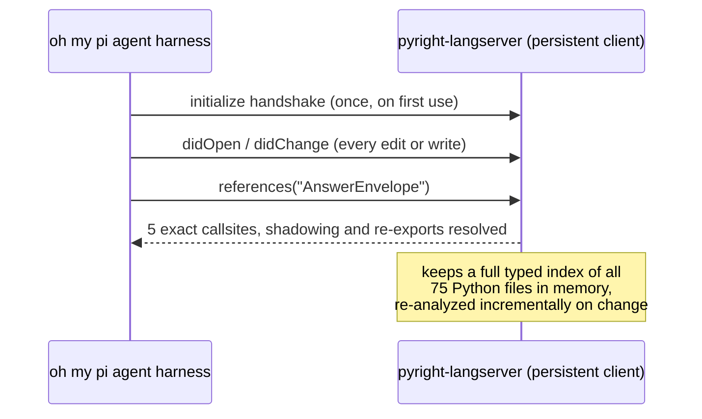

+++
title = "Testing the oh my pi agent harness and its wire ide LSP servers"
date = 2026-10-08
categories = ["AI Agents", "LSP", "Developer Tools"]
[params]
subtitle = "How the harness's LSP server beats traditional text tools — measured on a 75-file Python monorepo"
tech_meta = "OH MY PI / LSP / PYRIGHT / DAP"
math = false
+++

## Testing the oh my pi agent harness and its wire ide LSP servers

*A measured comparison from a real Python monorepo — scenarios, token costs, and the cases where grep still wins.*

**This article is about testing the oh my pi agent harness and its wire ide LSP servers.** It compares the harness's LSP server against traditional text-based tooling (`grep`, `read`, `edit`) on the same task, in the same repository, with the same model — and the gap is not close.

## The problem

An AI coding agent working a 75-file Python monorepo asks a simple question: *where is `AnswerEnvelope` actually used?* The classic approach is a text search, a few file reads, some disambiguation. The modern approach is a Language Server Protocol (LSP) query. This article measures both on the same task, in the same repository, with the same model — and the gap is not close.

The repo is a `uv` workspace with 13 packages under `packages/`, ~689 KB of Python across 75 files, plus apps, tests, and docs. The agent runtime is the oh my pi agent harness, which ships both a persistent LSP client and a DAP debugger. Everything below is measured from that setup, not estimated.

---

## How an LSP server works in the oh my pi agent harness

### The architecture

The oh my pi agent harness spawns a language-server binary — `pyright-langserver` for Python in this repo — as a **long-lived client process** over stdio. Once running, the server speaks JSON-RPC and holds the entire codebase in memory as a **typed semantic model**, incrementally updated on every file change. A query against it is a lookup in that model, not a disk scan.



Three properties of this design matter for everything that follows:

1. **Statefulness.** Traditional tools (`grep`, `read`, `edit`) are stateless — every call re-scans bytes from disk. The LSP is the only tool in the loop that knows the code's *meaning*, not just its text.
2. **Cold start, lazy.** The harness's default is `lsp.lazy: true`: the server binary resolves on PATH at session start but only *spawns* on first use. A session that never issues an LSP call never pays the startup cost — and, as this article's origin story goes, also never gets the benefit.
3. **Incremental updates.** After the handshake, every `edit`/`write` pushes a `didChange` to the server, so subsequent queries see the post-edit world without re-indexing from scratch.

### The lifecycle in practice

A real session on this repo shows the states:

- Session start: `lsp status` reports `pyright (configured, not started), ruff (configured, not started)` — binaries resolve, no request has spawned them.
- First LSP call (e.g. `symbols` on `packages/contracts/src/contracts/models.py`): the server spawns, runs its handshake, and returns the full symbol tree — every class and field with line numbers, including `AnswerEnvelope @ line 202` with all 18 of its fields.
- Every subsequent call: in-memory lookup, no startup cost.

The oh my pi agent harness also supports a **shared daemon broker** (`lsp.shared: true` by default): one language server per project is shared across harness instances, so two concurrent sessions don't pay for two indexes.

### Configuration

The harness auto-detects servers from built-in definitions (`pyright`, `basedpyright`, `pylsp`, `ruff`, `typescript-language-server`, `rust-analyzer`, `gopls`, and ~45 others) using two filters: a root marker in the cwd (`pyproject.toml` qualifies this repo for pyright) and binary availability in project-local bins (`.venv/`, `node_modules/.bin/`) or `$PATH`.

Config files merge from low to high precedence: home-root (`~/lsp.json`), user config dir (`~/.omp/agent/lsp.json`), project config dir (`.omp/lsp.json`), cwd root (`lsp.json`). Partial overrides of built-ins are legal — you only specify the fields you change. After any config change, `lsp reload *` re-reads and shuts down stale clients.

One config trap worth naming: this repo's user-level `lsp.json` pins `pyright` to an absolute node path. It works, but auto-detection would have found the same binary with zero config — the config only earns its keep when overriding *settings* or pinning a nonstandard binary.

---

## The tool surface: what replaces what

| Instead of (traditional) | Use (LSP op) | Why it wins |
|---|---|---|
| `grep` for a symbol's usages | `references` | Follows re-exports, aliased imports, and shadowed locals; text tools can't distinguish usage from mention |
| grep + read hunting for a definition | `definition` / `type_definition` / `implementation` | Direct jump, no scanning |
| `sed`/`replace_all` for renames | `rename` / `rename_file` | Rewrites all references *including aliased imports* — blind string replace silently drops callsites |
| reading a file to guess its API | `symbols` / `hover` | Full symbol tree or type at a position, without reading the body |
| re-running `mypy`/`ruff` after an edit | `diagnostics` | Type errors in seconds, not a full gate run; the harness can return them automatically after each `edit` |
| hand-fixing imports | `code_actions` | Server-known quick-fixes, applied in one call |

The LSP is *not* a replacement for everything. Content search where you don't know the symbol name — prose, string literals, config values, log formats — remains `grep`'s job. The LSP answers questions about *symbols*; grep answers questions about *text*.

---

## Scenario walkthroughs

All three scenarios below ran for real on the monorepo. Counts are the actual tool outputs.

### Scenario 1: Find every callsite of `AnswerEnvelope`

**The task:** the contracts model changed; find every usage to assess blast radius.

**Traditional approach.** A grep for `AnswerEnvelope` across `packages/` returns **60 matched rows** across 12 files: the class definition, the `__all__` re-export, import blocks in 8 files, type annotations, constructor calls, and function signatures. The result is ~8.2 KB of text — and critically, *it does not answer the question*. The import rows and re-export are mentions, not usages. Assessing real blast radius requires reading the definition file (~5 KB with a selector) plus targeted follow-up reads to disambiguate shadowed or string matches. Realistic total: **~5,900 tokens** across 4+ tool calls.

**LSP approach.** `references` on the `AnswerEnvelope` class symbol returns **5 exact results**:

```
packages/contracts/src/contracts/__init__.py:27:5
packages/contracts/src/contracts/__init__.py:82:6   (the __all__ re-export)
packages/contracts/src/contracts/api.py:9:5
packages/contracts/src/contracts/api.py:88:14       (the real consumer: phase_a field)
packages/contracts/src/models.py:202:7    (the definition)
```

One call, ~1.1 KB, semantic truth: 5 references, with the definition, the re-export, and the two genuine consumption sites distinguished. **~275 tokens**, no follow-ups.

**The interesting part:** grep found 60 rows and the truth was 5 references. The 55 surplus rows aren't noise to skip — they're ambiguity to resolve, and resolving them costs reads. The LSP collapses ambiguity into the answer itself.

### Scenario 2: Rename `AnswerEnvelope` across the workspace

**The task:** the model is being renamed; update every reference.

**Traditional approach.** Grep (~8.2 KB), then read every touched file to edit in context (12 files, ~60 KB of reads), then the edits themselves. A blind string `replace_all` is faster but *dangerous in exactly the way this repo has been burned before*: it rewrites string literals, comments, and unrelated matches, and it misses aliased imports (`from my_package.contracts import AnswerEnvelope as AE`). Realistic total: **~18,200 tokens** with full verification.

**LSP approach.** `rename` with `new_name` — the server resolves every reference *through its semantic model* (including aliased imports and re-export chains), applies the rename as a workspace edit, and returns the changed-files list. **~625 tokens** for the call plus result.

This is the scenario where the gap is widest (**29x**) and where text renames fail *silently* rather than expensively — the worst failure mode, because the missed callsite surfaces later as a runtime `NameError` or, worse, a dead code path.

### Scenario 3: Type-check after an edit

**The task:** the agent just edited `repository.py`; did it break the types?

**Traditional approach.** Run the full `mypy` gate (slow — seconds to minutes on a 13-package workspace) or eyeball the diff and hope.

**LSP approach.** `diagnostics` returns pyright's current errors for the file in milliseconds — the server already re-analyzed the post-edit file via `didChange`. The harness can be configured to return diagnostics automatically after every edit (`lsp.diagnosticsOnEdit: true`), which turns this from a remembered step into an always-on check. On this repo, that setting catches type errors in seconds instead of waiting for the full gate — the gate still runs at the end, but it's no longer the first line of defense.

### Scenario 4: Understanding an unfamiliar package

**The task:** the agent needs to work in `packages/lattice_core`, a package it has never read.

**Traditional approach.** Read the `__init__.py`, follow imports, read 3–5 more files. Easily 15–30 KB.

**LSP approach.** `symbols` on the entry file returns the full outline in one call; `hover` on any unfamiliar name returns its type and docstring at the position. Typically 2–4 KB total.

---

## Token efficiency: the measured comparison

Grounded in the actual tool outputs above (corpus: 75 files / ~689 KB of Python):

| Scenario | Traditional tools | LSP | Ratio |
|---|---|---|---|
| Find all callsites | ~5,900 tok | **~275 tok** | **21x** |
| Rename across 12 files | ~18,200 tok | **~625 tok** | **29x** |
| Type-check after edit | full gate run | **milliseconds, ~100 tok** | — |
| Understand unfamiliar package | ~15–30K tok | **~2–4K tok** | ~7x |

LSP's only overhead is fixed and small: roughly **600 tokens per session** for the tool descriptor and status reporting, amortized to nothing across any real task.

Two structural reasons for the gap:

1. **Answer vs. evidence.** The LSP returns *the semantic answer* — 5 callsites, all rename targets, current diagnostics. Traditional tools return *raw text that may or may not be the answer* — 60 grep rows, most of which are imports needing more reads to disambiguate. The token cost of traditional tools is the cost of the evidence, not the answer.
2. **Flat vs. corpus-scaling.** An LSP query searches an in-memory index and stays flat regardless of repo size. A forced raw read of this repo's Python corpus would cost **~172,000 tokens**; at 10x the codebase size, the LSP query is unchanged while the read-based approaches scale linearly with it.

---

## When grep still wins

- **Content search with no symbol name:** prose, string literals, error messages, config values, log formats. The LSP indexes symbols, not text.
- **Cross-language or non-code files:** YAML, SQL migrations, Dockerfiles — unless a matching server is configured (`yamlls`, `dockerls` exist in the harness's defaults).
- **One-shot tiny repos:** a 3-file script doesn't amortize the ~600-token session overhead — though the absolute cost is trivial either way.
- **Fast-changing generated code:** if files regenerate faster than `didChange` propagates, grep is the ground truth.

The right mental model: **grep is for finding text you can't name; LSP is for the code you can.** Most agent work on an established codebase is the latter.

---

## Practical setup in the oh my pi agent harness

For a workspace like this one:

1. **Do nothing for LSP** — `pyright` auto-detects via `pyproject.toml` + `.venv/bin/pyright-langserver`. Verify with `lsp status` (`configured, not started` is normal; `ready` after first use).
2. **Two settings worth flipping:** `lsp.diagnosticsOnEdit: true` (diagnostics after every edit) and `task.enableLsp: true` (subagents get the LSP tool — off by default, which silently locks delegated work out of symbol-aware navigation).
3. **For DAP:** the built-in `debugpy` adapter requires a `python` binary on PATH; venv-only machines need either a symlink (`~/.local/bin/python → .venv/bin/python`) or a `.omp/dap.json` pinning the adapter command to the venv interpreter. Note the availability gate checks PATH regardless of the config file — the symlink is the part that actually unblocks launches.
4. **Project-specific overrides** go in `.omp/lsp.json` (or `.omp/dap.json` for debuggers); user-wide preferences in `~/.omp/agent/lsp.json`.

---

## Summary

The LSP is not a faster grep — it's a different contract. Traditional tools return evidence the model must disambiguate; the LSP returns the semantic answer. Measured on a real 75-file Python monorepo: **21x fewer tokens to find callsites, 29x fewer to rename, type-checks in milliseconds instead of minutes** — for a fixed cost of ~600 tokens per session. The failure modes differ too: text renames miss callsites silently; the LSP cannot, because it resolves references through the same semantic model the type checker uses. For any established codebase, the economics and the correctness argument point the same direction.
